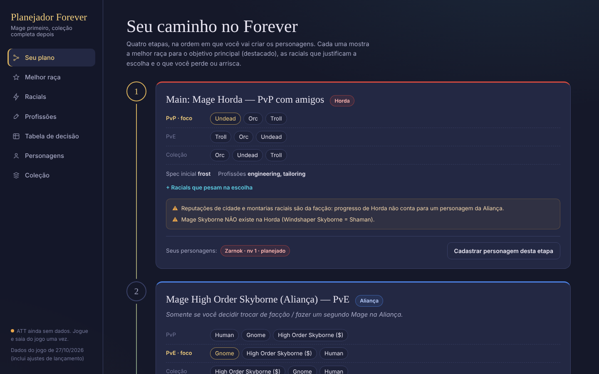
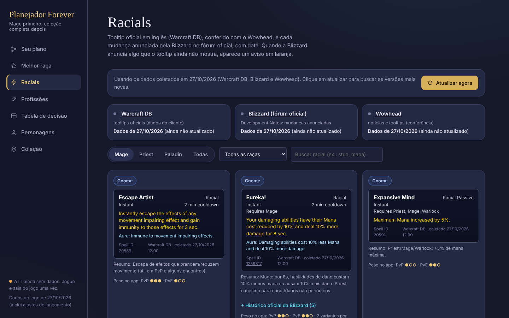
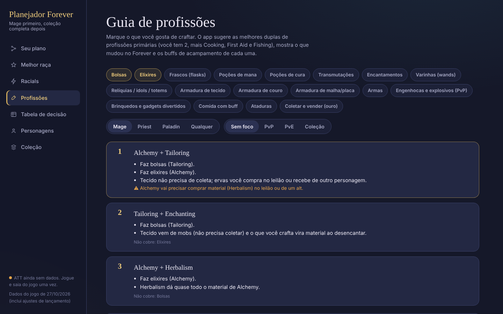
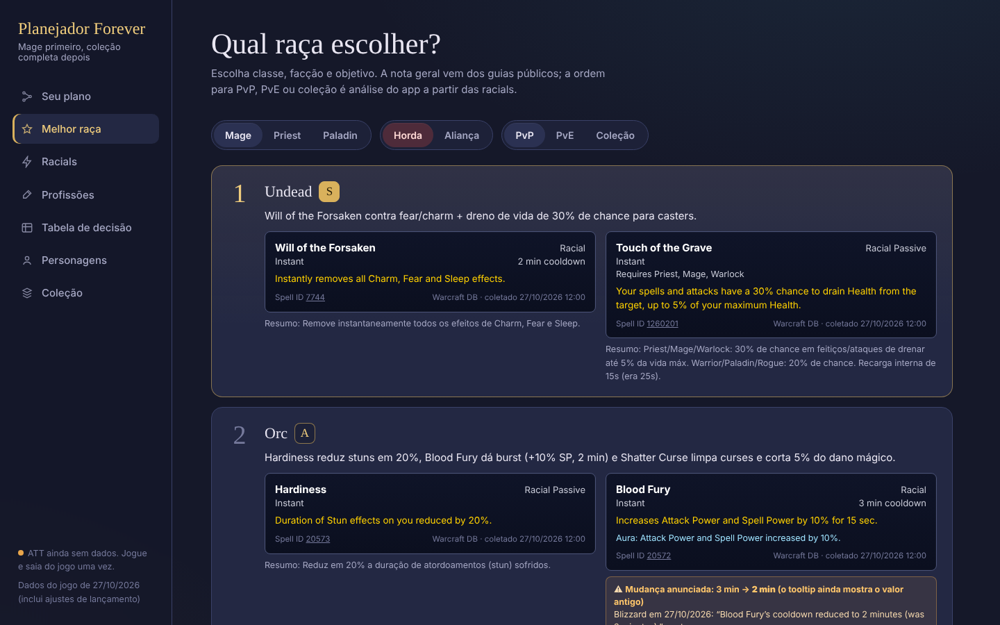
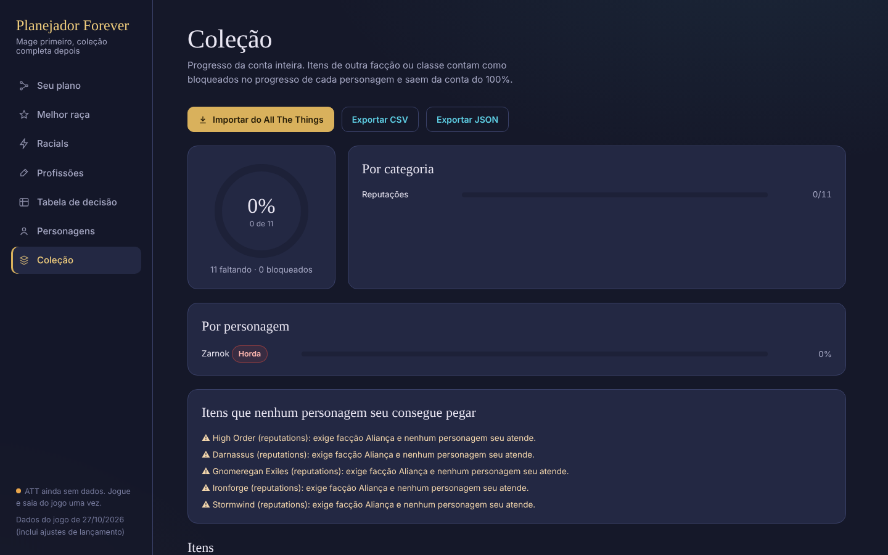

# wow-collection-planner

Planejador de personagens e colecionismo para **World of Warcraft: Forever**. Ele ajuda a escolher raça, entender as racials (com o tooltip oficial em inglês e as mudanças anunciadas pela Blizzard), escolher profissões pelo que você gosta de craftar e acompanhar sua coleção (montarias, pets, brinquedos, títulos, conquistas…) com import do All The Things.

Tudo roda no seu PC: interface no navegador, dados em SQLite local, nada de conta ou login.



## ⬇️ Download

1. Baixe o **`.zip` da [última versão](../../releases/latest)** (em *Assets*).
2. Extraia em qualquer pasta.
3. Dê dois cliques em **`setup.bat`**. Ele precisa do [Python 3.11+](https://www.python.org/downloads/); na instalação, marque *Add python.exe to PATH*.
4. Dê dois cliques em **`abrir-interface.bat`**.

Ficou com dúvida ou achou um dado errado? Abra uma [issue](../../issues/new/choose).

| Racials ao vivo | Guia de profissões |
|---|---|
|  |  |
| **Melhor raça** | **Coleção** |
|  |  |

> **Status dos dados (27/10/2026):** o Forever lança em **4/11/2026**. Os dados vêm do beta, dos posts da Blizzard sobre os ajustes de lançamento e de guias públicos. Use o botão **Atualizar agora** na aba Racials e rode `wow-plan update-game-data` depois de cada patch.

---

## ⚠️ Mage Skyborne = só Aliança

O Skyborne é uma raça "neutra" com **duas variantes fixas por facção**, e a facção define a classe exclusiva:

| Variante | Facção | Classes | Classe exclusiva |
|---|---|---|---|
| **High Order Skyborne** | Aliança | Druid, Hunter, **Mage**, Rogue, Warrior | **Mage** |
| **Windshaper Skyborne** | Horda | Druid, Hunter, Rogue, **Shaman**, Warrior | **Shaman** |

Ou seja: **não existe Mage Skyborne na Horda.** O app recusa essa combinação no `character add` e avisa
em `recommend`/`roadmap`. Skyborne também **exige compra** (Skyborne Heroic Pack, Epic Pack ou
Warcraft Forever Collection) — marcado com `($)` na CLI.
Fonte: [anúncio oficial da Blizzard](https://news.blizzard.com/en-us/article/24302071).

---

## Instalação

Requer Python 3.11+.

**Windows (jeito mais fácil):** dê dois cliques em `setup.bat`. Ele acha o Python 3.11+, cria `.venv`,
instala as dependências, cria o `.env`, roda `wow-plan init` e os testes. Depois:

```bat
wow-plan roadmap        (o wow-plan.bat da pasta já usa o .venv, sem precisar ativar)
```

**Manual (qualquer sistema):**

```bash
cd wow-collection-planner
python -m venv .venv
# Windows: .venv\Scripts\activate    |   macOS/Linux: source .venv/bin/activate
pip install -e ".[dev]"
cp .env.example .env        # edite os caminhos do WoW/ATT
wow-plan init               # cria data/wow_planner.db, aplica migrations, carrega a semente
```

## Interface visual

Dê dois cliques em **`abrir-interface.bat`** (ou rode `wow-plan ui`). O navegador abre em
`http://127.0.0.1:8765` com cinco abas:

- **Seu plano**: as 4 etapas como uma cadeia de quests, com raças por objetivo, racials, riscos e um botão para cadastrar o personagem da etapa
- **Melhor raça**: escolha classe, facção e objetivo e veja o ranking com notas e racials
- **Racials**: tooltip de cada racial **em inglês, como no jogo**, notas oficiais da Blizzard com data, notícias do Wowhead e o botão **Atualizar agora**
- **Tabela de decisão**: Mage, Priest e Paladin × Horda/Aliança × PvP/PvE
- **Personagens**: cadastrar (o formulário só oferece raças válidas para a classe e a facção), mudar status e nível, excluir
- **Coleção**: progresso geral, por categoria e por personagem; importar do ATT com um clique; mudar o status de itens; exportar CSV/JSON

O servidor roda só no seu PC (escuta em 127.0.0.1) e para quando você fecha a janela preta do terminal.

## Uso rápido

```bash
wow-plan roadmap                                            # seu plano completo (4 etapas)
wow-plan recommend --class mage --faction horde --mode pvp  # aceita também: mago / horda / colecionismo
wow-plan recommend --class priest --faction alliance --mode pve
wow-plan decision-table                                     # tabela Mage/Priest/Paladin × facção × modo
wow-plan decision-table --markdown

# Personagens
wow-plan character add --name Zarnok --faction horde --race undead --class mage \
    --spec frost --goal pvp --order 1 --priority 1 --realm MeuReino --notes "PvP com a galera"
wow-plan character add --name Aelyn --faction alliance --race skyborne_high_order --class mage --goal pve --order 2
wow-plan character list
wow-plan character status Zarnok in_progress --level 25

# Coleção
wow-plan collection inspect-att                      # mostra a estrutura do seu AllTheThings.lua
wow-plan collection import --source att              # usa o caminho do .env
wow-plan collection import --source att --file export_att.csv   # export manual (CSV/JSON)
wow-plan collection import --source csv --file examples/manual_collection_template.csv
wow-plan collection status                           # geral, por categoria e por personagem
wow-plan collection status --character Zarnok
wow-plan collection missing --category mounts --faction horde
wow-plan collection missing --class mage --priority 2 --source vendor
wow-plan collection set "Orgrimmar" in_progress --progress 60
wow-plan collection alerts                           # itens restritos que nenhum personagem seu cobre
wow-plan collection export --format csv              # ou --format json

# Game data
wow-plan update-racials                              # Blizzard + Warcraft DB + Wowhead: mudanças e avisos
wow-plan update-game-data                            # valida e lista registros velhos (--max-age 30)
wow-plan update-game-data --from minha_pasta/        # importa YAML/JSON editado à mão
```

Raças aceitas (`--race`): `orc`, `undead`, `troll`, `tauren`, `skyborne_windshaper` (Horda);
`human`, `gnome`, `dwarf`, `night_elf`, `skyborne_high_order` (Aliança).

## O roadmap (`wow-plan roadmap`)

1. **Main: Mage Horda — PvP com amigos** · Undead > Orc > Troll
2. **Mage High Order Skyborne (Aliança) — PvE** · só se você trocar de facção; Gnome > Skyborne($) > Human em números
3. **Alt: Priest** · Horda (Troll/Undead) comparado lado a lado com Aliança (Human/Gnome/Dwarf/Night Elf)
4. **Alt: Paladin** · Horda só tem **Undead Paladin** (inédito); Aliança: Human ou Dwarf

Cada etapa mostra melhores raças por PvP/PvE/colecionismo, racials que importam, spec inicial,
profissões, riscos/trade-offs e quais personagens seus já cobrem a etapa.

## Tabela de decisão

| Classe | Melhor Horda PvP | Melhor Horda PvE | Melhor Aliança PvP | Melhor Aliança PvE | Observações |
|---|---|---|---|---|---|
| Mage | Undead (alt: Orc) | Troll (alt: Orc) | Human (alt: Gnome) | Gnome (alt: High Order Skyborne) | Undead e Orc são muito próximos: fear/charm → Undead; stun/curse/burst → Orc. Skyborne é viável (nota B) mas Gnome tem números melhores (nota S). |
| Priest | Undead (alt: Troll) | Troll (alt: Undead) | Gnome (alt: Human) | Human (alt: Gnome) | Upe Shadow; troque para Holy/Discipline em dungeon/raide. Fear Ward virou base, Dwarf não é mais obrigatório. |
| Paladin | Undead | Undead | Human (alt: Dwarf) | Human (alt: Dwarf) | Undead é a única raça Paladin da Horda. |

**Como ler:** as notas gerais (S/A/B) por raça vêm do [RankedBoost](https://rankedboost.com/world-of-warcraft/forever/race/),
que **não separa PvP de PvE**. A divisão PvP/PvE, as specs e as profissões são **análise do app** a partir dos efeitos
das racials (`confidence: analysis` no YAML). Gere a versão atual com `wow-plan decision-table`.

---

## Integração com All The Things (ATT) — o que existe de verdade

Verificado em 27/10/2026 no ATT **5.4.5** instalado em `_forever_\Interface\AddOns\AllTheThings`
(o `.toc` declara `Interface: 16001` = WoW Forever 1.60.1, ou seja, **o ATT suporta o Forever**):

| Método | Existe? | Situação no app |
|---|---|---|
| API web pública do ATT | **Não** | Nenhum endpoint é usado. O app não faz chamadas de rede. |
| Formato de dados documentado | **Não** | Lido direto do código-fonte do addon (ver abaixo). |
| SavedVariables local (`AllTheThings.lua`) | **Sim** | ✅ Importador lê o arquivo direto; mapeamento verificado contra o código do ATT 5.4.5. |
| Janela "Export" do ATT (`/att export`) | Sim, só copiar/colar | Use para gerar texto e salvar como CSV → `--file`. |
| Export manual (CSV/JSON) | Depende de você | ✅ Importador tolerante, com mapeamento de colunas em YAML. |

Estrutura real (do código do ATT):

- `ATTAccountWideData.<Cache>[id]` → `1` obtido na conta, `2` obtido por outro personagem, `3` conquista
- `ATTCharacterData[<GUID>]` → `{ name, realm, lvl, race, class, ..., <Cache>[id] = 1 }`
- Caches: `Mounts`, `BattlePets`, `Toys`, `Titles`, `Achievements`, `Factions` (Exalted), `Sources` (transmog), `Spells` (receitas), `Quests`

Personagens do ATT são casados pelo **nome do jogo** com os cadastrados no app; os que não estiverem
cadastrados aparecem listados no fim do import.

Pontos importantes:

- **O arquivo só existe depois que você loga no Forever com o ATT ligado e desloga (ou dá `/reload`).**
  Hoje ainda não há pasta `WTF` em `_forever_`, então o import vai dizer "arquivo não encontrado" até lá.
- O caminho fica em `WTF\Account\<SUA CONTA>\SavedVariables\AllTheThings.lua` — o app acha sozinho.
- Se uma versão futura do ATT mudar a estrutura, o import só avisa; rode `wow-plan collection inspect-att`.

### Configurando o caminho

O `.env` já vem apontando para a sua instalação:

```ini
WOW_PATH=C:\Program Files (x86)\World of Warcraft
WOW_FLAVOR=_forever_
WOW_ACCOUNT=                  # opcional; vazio = procura em todas as contas
# ou caminho direto (prioridade):
ATT_SAVEDVARIABLES_PATH=
```

### Ajustando o mapeamento (recomendado antes do 1º import real)

```bash
wow-plan collection inspect-att                 # lista tabelas de 1º/2º nível e tamanhos
cp src/wow_planner/importers/att_mapping.default.yaml meu_mapping.yaml
# edite os `path` para as tabelas que existem no seu arquivo e mude `verified: true`
# .env -> ATT_MAPPING_PATH=meu_mapping.yaml
wow-plan collection import --source att
```

Cada regra do YAML aponta uma tabela `{id = valor}` para uma categoria do app. `scope: character` lê uma tabela
`{"Nome-Reino" = {...}}` e aplica o status ao personagem cadastrado de mesmo nome. Valores `true`/`1`/número > 0
contam como obtido. Itens vindos só de ID ficam como `categoria #id`; para dar nome, importe um CSV com
`external_source=att` e o mesmo `external_id` — o nome é atualizado sem perder o status.

### Export manual

`--file arquivo.csv|.json` com `--source att` usa a seção `manual_columns` do YAML para reconhecer colunas
como `id`, `itemID`, `Name`, `type`, `collected`, `faction`... (CSV com `,`, `;` ou tab). Linhas inválidas
viram aviso; o resto é importado.

---

## Colecionismo

- **Categorias:** mounts, pets, toys, transmogs, appearances, achievements, meta_achievements, titles,
  reputations, reputation_mounts, recipes, seasonal, other.
- **Status:** não obtido (`missing`), obtido (`collected`), em progresso (`in_progress`, com %), bloqueado (`blocked`).
  Há status **de conta** e **por personagem** (o do personagem tem precedência).
- **Bloqueio automático:** no progresso de um personagem, itens de outra facção/classe/raça contam como bloqueados
  e saem do denominador do "faltam para 100%".
- **Alertas** (`collection alerts`): itens restritos a uma facção/classe/raça que nenhum personagem cadastrado cobre.
- **Semente:** o `init` carrega só reputações de capital/Skyborne verificadas em guias. Montarias, pets, transmogs etc.
  **não foram inventados** — vêm do ATT ou do seu CSV (modelo em `examples/manual_collection_template.csv`).

**Não verificado ainda:** quanto da coleção (montarias, transmog, conquistas) é compartilhado na conta entre facções
no Forever. Por isso `account_wide` fica vazio na semente e o roadmap lista isso como risco de trocar de facção.

---

## Racials ao vivo: Blizzard + Warcraft DB + Wowhead

O botão **Atualizar agora** na aba Racials (ou `wow-plan update-racials`) consulta três fontes. Se uma falhar, as outras
continuam, e nada salvo é apagado. Cada fonte mostra na interface a data e hora da última atualização.

| Fonte | O que traz | Endpoint |
|---|---|---|
| **Blizzard** (oficial) | Development Notes do fórum US e EU: cada linha que cita uma racial, com **data do post e da edição** | `us.forums.blizzard.com/en/wow/t/2360696.json` (Discourse) + busca de tópicos novos da Blizzard |
| **Warcraft DB** | Tooltip do cliente em inglês: cast, cooldown, alcance, custo, aura, Spell ID; descobre variantes por classe | `forever.warcraftdb.com/api/v1/search` e `/api/v1/tooltip/spell/<id>` |
| **Wowhead** | Notícias do Forever (RSS, com data) e tooltip da base Forever para conferência | `wowhead.com/news/rss/forever`, `nether.wowhead.com/forever/tooltip/spell/<id>` |

- **Aviso laranja:** quando a nota mais recente da Blizzard diz "X (was Y)" e o tooltip ainda mostra Y, o app avisa
  "Mudança anunciada: Y → X (o tooltip ainda mostra o valor antigo)", com a data e o link do post.
- **Histórico oficial:** cada racial lista todas as notas da Blizzard, da mais nova para a mais antiga.
- **Wowhead confere / difere:** compara o tooltip do Wowhead com o do Warcraft DB.
- Só entram posts de funcionários da Blizzard (posts de jogadores são ignorados).
- Nenhuma dessas APIs é documentada para uso externo. Se o formato mudar, o update mostra o erro e mantém os dados.

### Ajustes de lançamento já aplicados (anunciados em 26/10 e 27/10/2026)

| Racial | Beta (tooltips atuais) | Lançamento (Blizzard) |
|---|---|---|
| Ruthless (Human) | +2% crit | +1% crit |
| The Human Spirit | +5% Spirit | +10% Spirit |
| Earth Fury (Dwarf) | +2% bônus crítico | removida → **Artisan's Precision** (+1% hit) |
| Savage (Orc) | +1% crit | removida → **Command** (+5% dano de pet) |
| Blood Fury (Orc) | recarga 3 min | recarga 2 min |
| Touch of the Grave (Undead) | ICD 25 s | ICD 15 s |
| Endurance (Tauren) | +5% vida, +2% bônus crítico | só +5% vida |
| Plainsrunning (Tauren) | até 30%, +3% montado | 2%/stack até 60%, sem montado |
| Wind Blessed (Skyborne) | +3% haste | +2% haste |
| Read Leyline (High Order) | +100% regen | +50% por 15 s; +100% com Attuned (1 h, sai em raide) |
| Skysight (Windshaper) | +10% velocidade | +15% por 15 s; +30% com Charged (1 h, sai em raide) |

As recomendações já usam esses valores. Os tooltips do Warcraft DB e do Wowhead ainda mostram os números do beta;
quando eles atualizarem, o aviso laranja some sozinho no próximo update.

## Guia de profissões (aba **Profissões** / `wow-plan professions`)

Marque o que você gosta de craftar e o app sugere as 3 melhores duplas de profissões primárias para a sua classe e objetivo. Também mostra o que mudou no Forever e os buffs de acampamento (camping) de cada profissão.

```
wow-plan professions --likes bolsas,elixires --class mage
wow-plan professions --list          # todos os interesses aceitos
```

| Você gosta de… | Dupla sugerida | Por quê |
|---|---|---|
| Bolsas + elixires | **Tailoring + Alchemy** | O tecido cai de mobs, então não precisa coletar. As ervas você compra ou recebe de um alt com Herbalism. |
| Bolsas, wands, gear de caster | **Tailoring + Enchanting** | O que você crafta vira material ao desencantar. Wands de Enchanting agora têm spell power. |
| Elixires e flasks sem depender do leilão | **Alchemy + Herbalism** | Herbalism fornece quase todo o material. |
| PvP com os amigos | **Engineering + Mining** | Gadgets e explosivos. Os "Saf T" podem ser vendidos para quem não é engenheiro. |
| Armas e placa (Paladin) | **Blacksmithing + Mining** | |

Mudanças do Forever que importam:
- As **Healing Potions** (Minor a Major) saíram de Alchemy e foram para **First Aid**, que é secundária. Qualquer personagem faz.
- A Red Linen Bag agora tem **8 slots**.
- Existe um **slot de bolsa de reagentes** (Linen e Woolen Reagent Bag, de Tailoring).
- Não existe mais bônus passivo de profissão. O ganho vem dos crafts e dos objetos de acampamento.
- Os buffs de acampamento não acumulam com o buff da classe equivalente.

Se você marcar coisas demais para 2 profissões, o app divide entre Mage, Priest e Paladin. Exemplo: Mage com Tailoring + Enchanting, Priest com Alchemy + Herbalism.

Os dados ficam em `game_data/data/professions.yaml`, com `source` e `last_verified` em cada profissão. As fontes são o Warcraft Tavern (guias de Forever) e o RankedBoost. As notas de encaixe por classe e objetivo são análise do app.

## Banco de conhecimento (`game_data`)

```
src/wow_planner/game_data/data/
  races.yaml            raças, facção, classes, racials, zona, reputação, notas gerais (RankedBoost)
  racials.yaml          efeito, tipo, cooldown (null = não verificado), valor PvP/PvE (avaliação do app)
  recommendations.yaml  raças por classe × facção × modo, spec inicial, profissões
  roadmap.yaml          as 4 etapas do seu plano + riscos
  collection_seed.yaml  colecionáveis-semente verificados
```

Todo registro tem `source`, `last_verified` e `confidence` (`official` · `guide` · `community` · `analysis` · `unverified`).
O loader checa integridade (raça × classe × facção, racials existentes) e **recusa** dados inconsistentes —
por exemplo, uma recomendação de Mage com `skyborne_windshaper`.

Para atualizar depois de um patch: copie o YAML, edite, ajuste `last_verified` e rode
`wow-plan update-game-data --from pasta/`. Os arquivos validados vão para `WOW_PLAN_DATA_DIR` e passam a ter
prioridade sobre os embutidos; cada carga fica registrada em `game_data_snapshots` no SQLite.

**Lacunas conhecidas** (aparecem no `update-game-data`): 24 racials ativas sem cooldown publicado, efeito exato de
Will of the Forsaken/Hardiness/Will to Survive no Forever, e tier lists separadas PvP/PvE pós-lançamento.

### Fontes usadas (26/10/2026)

- Blizzard — [Skyborne: classes por variante](https://news.blizzard.com/en-us/article/24302071)
- Warcraft Tavern — [Races Guide](https://www.warcrafttavern.com/forever/guides/races/) · [Racial Abilities](https://www.warcrafttavern.com/forever/guides/racial-abilities/)
- RankedBoost — [Races e racials comparados](https://rankedboost.com/world-of-warcraft/forever/race/)
- Warcraft Wiki — [World of Warcraft: Forever](https://warcraft.wiki.gg/wiki/Forever)
- CurseForge — [ALL THE THINGS](https://www.curseforge.com/wow/addons/all-the-things)

---

## Estrutura

```
src/wow_planner/
  cli/            main.py (typer + rich)
  models/         pydantic: character, collection, game
  repositories/   db.py (sqlite3 + migrations), character_repo, collection_repo
  services/       recommendation, roadmap, collection (progresso/filtros/export), game_data
  game_data/      loader + data/*.yaml
  live/           warcraftdb.py, blizzard.py, wowhead.py, runner.py (fontes ao vivo, diff, avisos)
  web/            server.py (http.server local), api.py, static/index.html
  importers/      lua_table.py (parser tolerante de SavedVariables), att_importer.py, att_mapping.default.yaml
  migrations/     001_initial.sql
tests/            59 testes (recomendações, roadmap, parser Lua, importador ATT, progresso, CLI) + fixtures ATT simuladas
```

```bash
pytest -q
```

---

## Licença e aviso

Código sob [licença MIT](LICENSE). Veja também o [CHANGELOG](CHANGELOG.md) e [como contribuir](CONTRIBUTING.md).

World of Warcraft, Warcraft e Blizzard Entertainment são marcas registradas da Blizzard Entertainment, Inc. Este é um projeto de fã, **sem afiliação nem endosso da Blizzard**. Os tooltips e trechos de posts exibidos pertencem aos seus autores e são mostrados com link para a fonte original.
